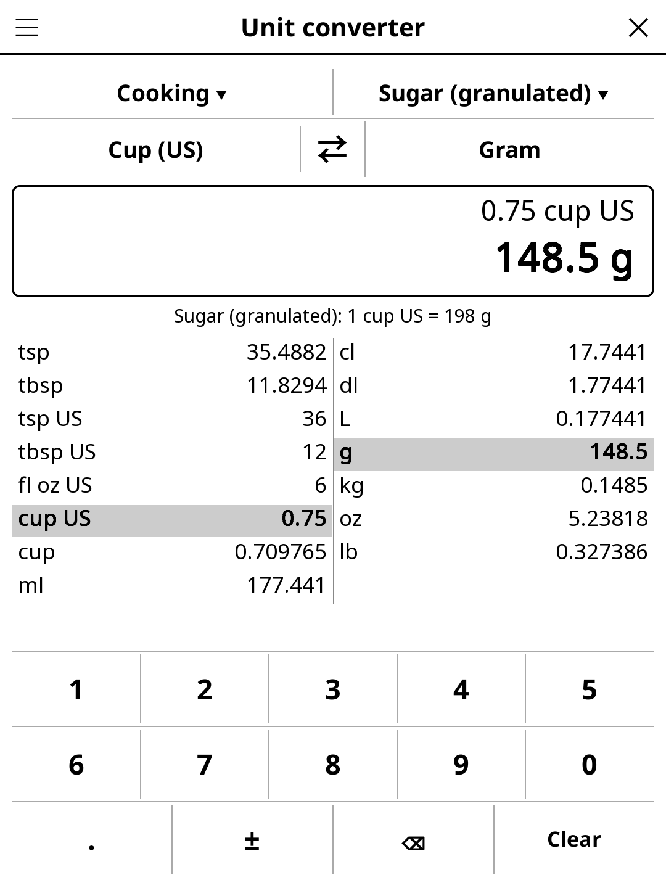

# converter.koplugin

A unit converter for [KOReader](https://github.com/koreader/koreader):
units, cooking measures, oven temperatures, currencies, time zones, Roman
numerals and number bases, on one screen made for e-ink and touch.

## Screenshot

## Features

- **One screen** — category, *from* and *to* units (⇄ swaps them), a big
  result, and the value in every unit of the category. Tap a line of that
  table to make it the target unit.
- **Live result** — type on the on-screen keypad; the decimal separator
  follows the UI language (comma in French).
- **Exact factors** — length, mass, volume, temperature, area, speed,
  duration, fuel consumption (L/100 km ↔ km/L ↔ mpg US/UK), energy,
  pressure, data size (kB/MB/GB and KiB/MiB/GiB) and angle, from the SI
  Brochure and NIST SP 811.
- **Cooking** — teaspoons, tablespoons (metric 5/15 ml and US), cups and
  fluid ounces ↔ grams for 25 ingredients (flour, sugar, caster sugar,
  butter, rice, milk, honey, cocoa, oats…), weights from the King Arthur
  Baking ingredient weight chart and USDA FoodData Central.
- **Oven** — °C ↔ °F ↔ gas mark ↔ French *thermostat* (th. 6 = 180 °C),
  rounded as an oven dial shows them.
- **Currencies** — euro reference rates of the European Central Bank.
  A snapshot ships with the plugin so it works offline; ☰ → *Update
  exchange rates* (or tap the rate date) fetches the latest ones over
  Wi-Fi. The date of the rates in use is always shown.
- **Time zones** — what time it is in 55 cities, daylight saving time
  included, or what a typed time becomes elsewhere. Set ☰ → *My time zone*
  if the reader's clock does not know its own zone.
- **Number tools** — Roman numerals (1–3999) and bases (binary, octal,
  decimal, hexadecimal), each with its own keypad.
- **Remembers** the category, units and value; ☰ → *Recent conversions*
  and *Favourites*.
- English, French, Spanish and German.

## Installation

1. Download `converter.koplugin.zip` from the [latest release](../../releases/latest).
2. Extract into the `plugins/` folder of your KOReader data directory.
3. Restart KOReader.
4. Open the menu → **Tools** → **Unit converter**.

## Controls

| Action | How |
|--------|-----|
| Change category | Tap the top-left button, or ☰ → Category |
| Change a unit | Tap the *from* or *to* button |
| Swap units | Tap ⇄ |
| Make a unit the target | Tap its line in the table |
| Ingredient / rates / home zone | Tap the top-right button |
| Recent, favourites, help | ☰ menu |

## Accuracy notes

- Month and year (Duration) are Gregorian-calendar averages.
- Measuring dry ingredients by volume is approximate by nature.
- ECB rates are published for information; banks and card payments use
  other rates.
- Time-zone rules are those in force in 2026; dates before a city's
  current rules came in may be an hour off.

## License

GPL-3.0 — see [LICENSE](LICENSE).
